# Foto-Globus für Synology

[](https://github.com/rinkelzz/foto-globus/actions/workflows/ci.yml)
[](https://github.com/rinkelzz/foto-globus/releases)
[](LICENSE)

Deine Fotos und Videos aus **Synology Photos** als Pinnadeln auf einer drehbaren **Weltkugel** – direkt auf der
eigenen NAS, als Paket mit eigenem Fenster in DSM. Jede Nadel zeigt, wie viele Fotos an diesem Ort entstanden sind.
Ein Klick öffnet die Galerie, von dort geht es in die Großansicht, zum Video oder zum Original. Mit Ortsnamen,
Suche, Statistik, eingefärbten Reiseländern, automatisch erkannten **Reisen mit Route**, die sich als Kamerafahrt **nachspielen** lassen, Heatmap und
Satellitenbild. Persönliche Fotos sieht nur der
Besitzer, gemeinsame Fotos richten sich nach den **Ordnerrechten in DSM**.

[](https://buymeacoffee.com/lapalutschi)

Dir gefällt der Foto-Globus? Über einen Kaffee freue ich mich – die App bleibt natürlich kostenlos.

*English summary: [below](#english).*

| Weltkugel mit Pinnadeln | Galerie eines Ortes |
|---|---|
| 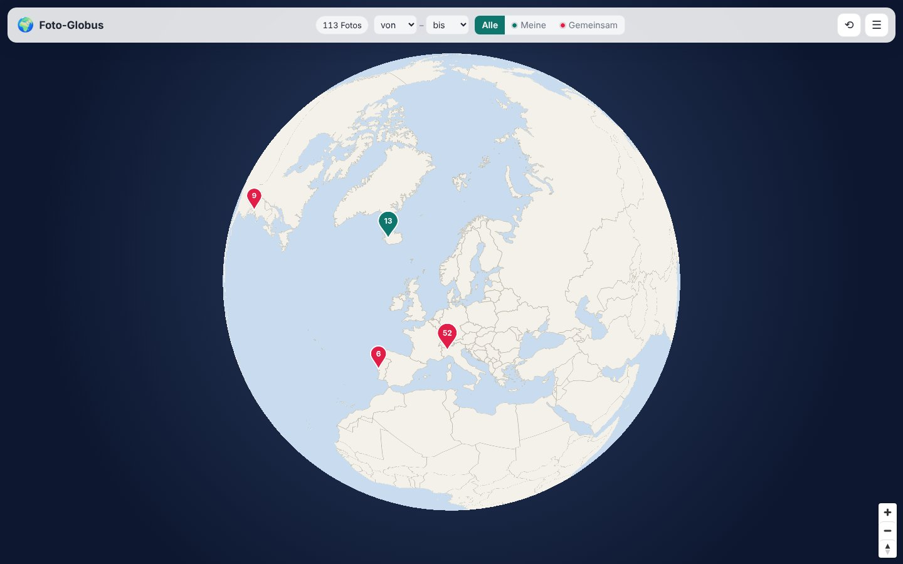 | 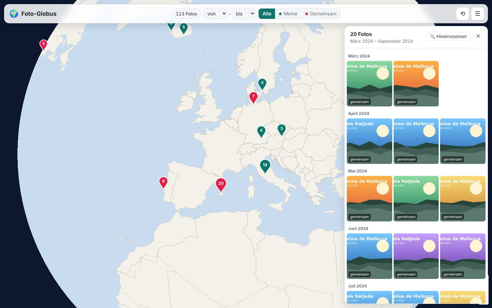 |

| Suche nach Ort oder Land | Statistik „Meine Welt“ |
|---|---|
| 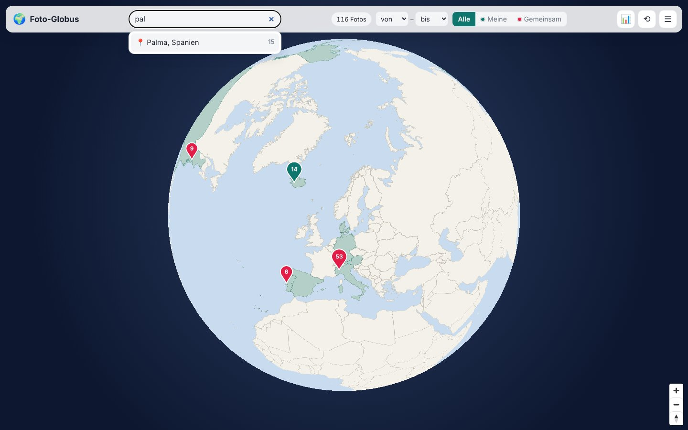 | 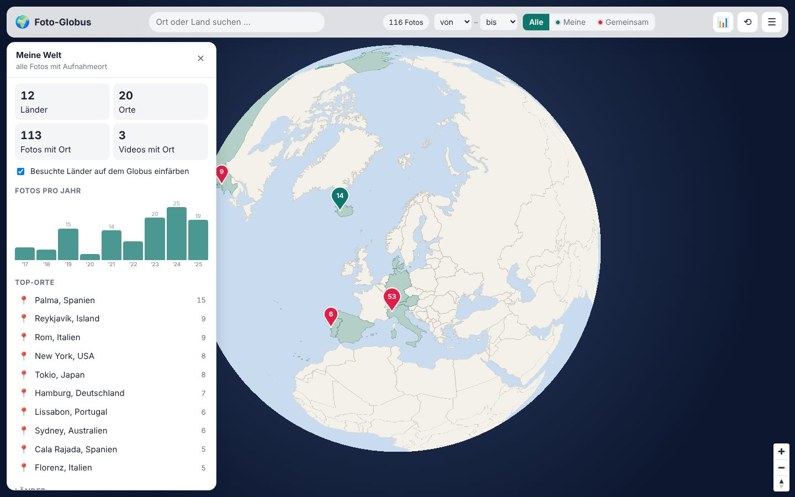 |

| Reisen | Reise mit Route |
|---|---|
| 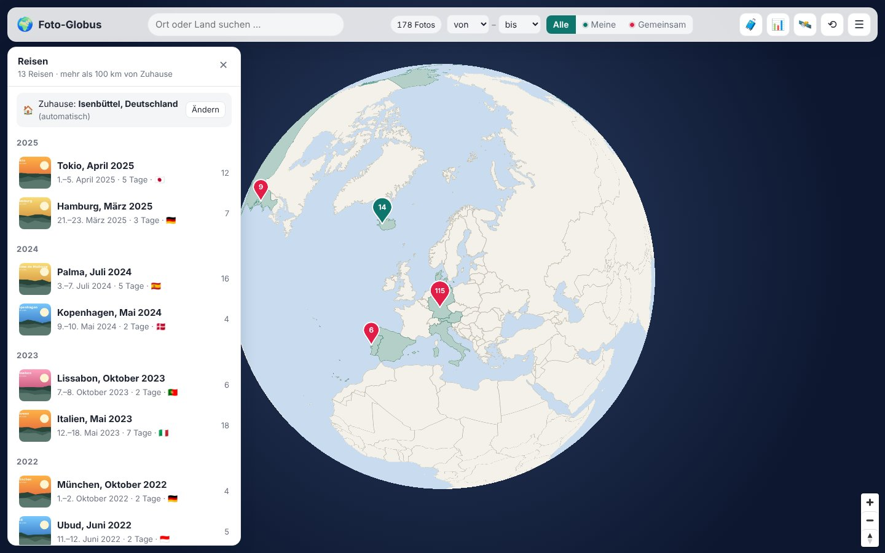 | 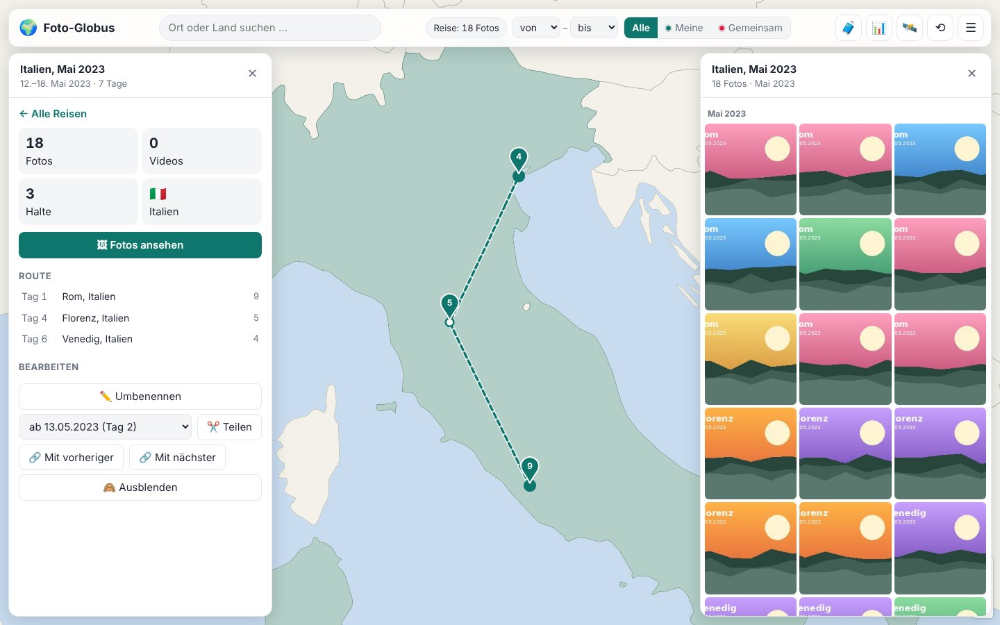 |

| Reise nachspielen | Heatmap |
|---|---|
| 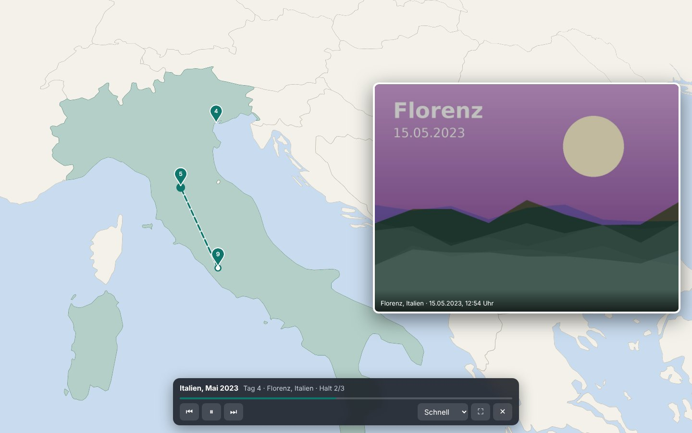 | 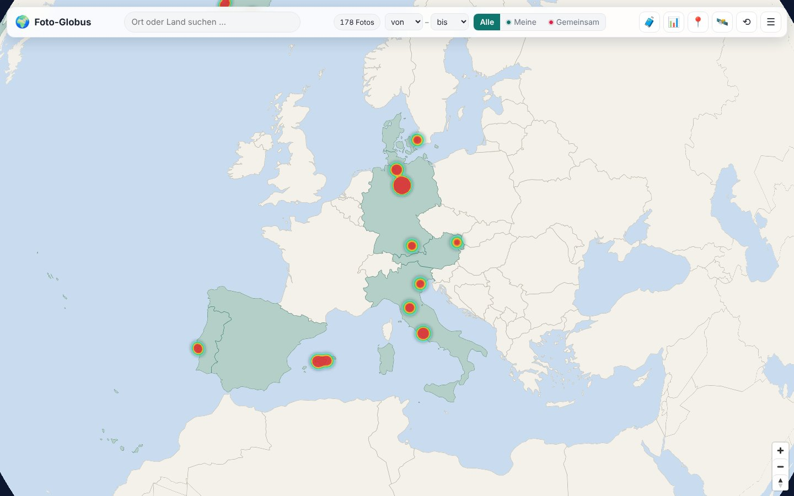 |

| Videos abspielen | Am Handy |
|---|---|
| 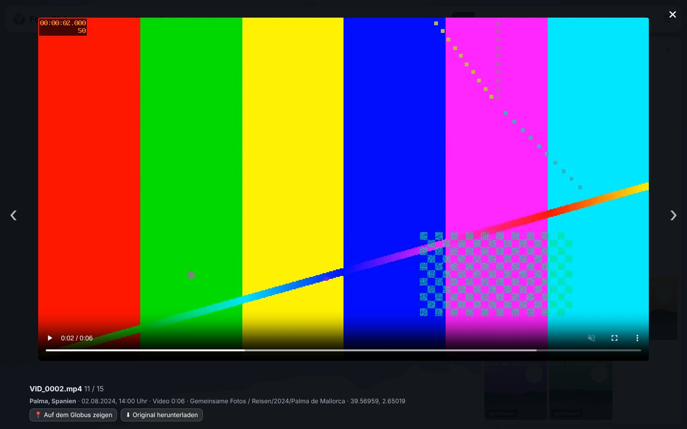 | 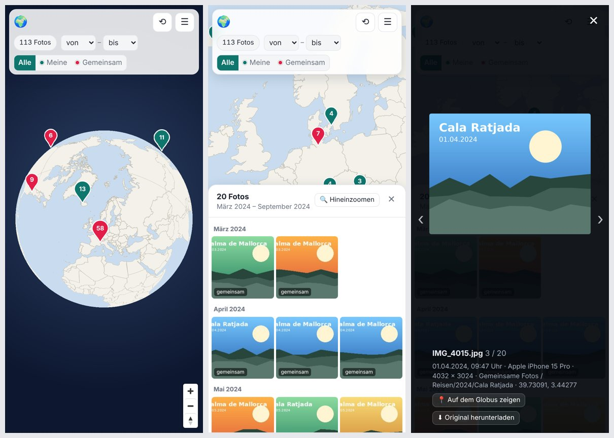 |

| Einstellungen: Ordner und Rechte | Einstellungen: Suche |
|---|---|
| 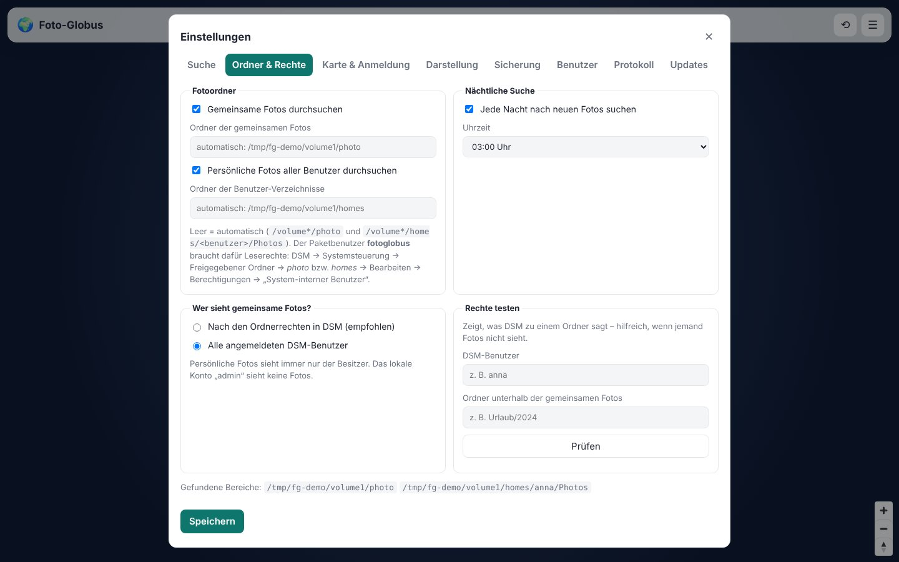 | 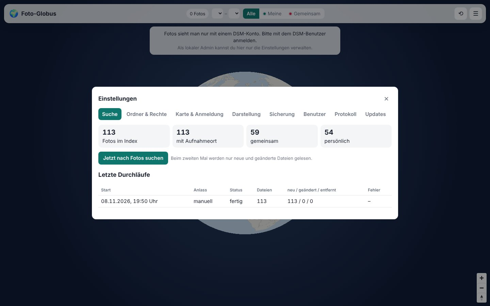 |

*(Screenshots mit Demo-Bildern und der schlichten Offline-Kugel. Mit Internet zeigt der Globus eine Straßenkarte.)*

## Inhalt

- [Funktionen](#funktionen)
- [Installation auf der Synology](#installation-auf-der-synology)
- [Wer sieht welche Fotos?](#wer-sieht-welche-fotos)
- [Karte und Datenschutz](#karte-und-datenschutz)
- [Updates, Sicherung, Port](#updates-sicherung-port)
- [Entwicklung](#entwicklung)
- [Pläne](#pläne)
- [Lizenz](#lizenz)

## Funktionen

- **3D-Weltkugel** zum Drehen und Zoomen (MapLibre GL, liegt im Paket). Nahe Fotos werden zu einer **Pinnadel mit Zahl**
  zusammengefasst und teilen sich beim Hineinzoomen auf. **Grün = meine Fotos, rot = gemeinsame.**
- **Galerie** pro Pinnadel mit Ortsnamen als Titel, nach Tag bzw. Monat gruppiert, Vorschaubilder werden erst beim
  Scrollen geladen.
- **Ortsnamen** wie „Palma, Spanien“ – offline aus GeoNames (alle Orte ab 1.000 Einwohnern), bekannte Orte auf Deutsch.
- **Suche** nach Ort oder Land: der Globus fliegt hin und öffnet die Fotos.
- **Statistik „Meine Welt“**: Länder, Orte, Fotos pro Jahr (Klick filtert), Top-Orte, Länderliste – und die
  **besuchten Länder** werden auf dem Globus eingefärbt.
- **Reisen** werden automatisch erkannt (mehr als 100 km von Zuhause, höchstens 2 Tage ohne Fotos dazwischen) und
  mit **Route** von Halt zu Halt gezeigt. Umbenennen, teilen, zusammenführen, ausblenden – die Änderungen bleiben.
  Zuhause bestimmt die App selbst, man kann es aber per Klick auf den Globus setzen.
- **Reise nachspielen:** Die Kamera fliegt von Halt zu Halt, die Route zeichnet sich mit, an jedem Halt läuft eine
  kurze Diashow. Pause, Zurück/Weiter, Tempo, Vollbild – und als **Jahresrückblick** alle Reisen eines Jahres.
- **Heatmap** per Knopf 🔥 statt Pinnadeln: zeigt, wo die meisten Fotos entstanden sind.
- **Satellitenbild** per Knopf 🛰️: Esri ohne Schlüssel oder MapTiler mit eigenem Schlüssel.
- **In Synology Photos öffnen:** im DSM-Fenster direkt im Ordner des Fotos.
- **Videos** (MP4, MOV, M4V, 3GP) von iPhone, Android und Kameras: mit Ort, Zeit und Länge, **abspielbar** in der
  Großansicht (mit Spulen). Ist eine kleinere Fassung von Synology Photos da, wird die genommen.
- **Großansicht** mit Blättern (Pfeiltasten, Wischen am Handy), Ort, Aufnahmezeit, Kamera, Ordner, Koordinaten,
  „Auf dem Globus zeigen“ und **Original herunterladen**.
- **Filter:** Zeitraum (von/bis Jahr) und Bereich (alle, nur meine, nur gemeinsame).
- Liest **JPEG, HEIC/HEIF (iPhone), PNG, TIFF, DNG, NEF, ARW, CR2** – in reinem Python, ohne Pillow oder andere
  Bibliotheken mit C-Code. Die Vorschaubilder kommen von Synology Photos selbst (`@eaDir`), notfalls aus den Exif-Daten.
- **Nächtliche Suche** nach neuen Fotos (Uhrzeit einstellbar) plus „Jetzt suchen“. Ab dem zweiten Mal werden nur neue
  und geänderte Dateien gelesen; ist ein Volume gerade nicht da, bleibt der Index stehen.
- **Single Sign-on im DSM-Fenster**, sonst Anmeldung mit dem DSM-Konto (auch mit Zwei-Faktor-Code).
- Oberfläche auf Deutsch, für **Handy und Desktop**, vier Designs (Klassisch, Synology DSM, Nacht, Warm & groß),
  Firmenname und Logo in der Kopfzeile.
- **Datensicherung** jede Nacht (auch in einen freigegebenen Ordner für Hyper Backup), Wiederherstellen per Klick,
  **Änderungsprotokoll**, Updates über das **Paket-Zentrum**.

## Installation auf der Synology

Voraussetzung: DSM 7 und Python 3 (im Paket-Zentrum „Python 3.9“ oder neuer von SynoCommunity).
Ein Paket für alle Modelle: Intel/AMD sowie ARMv8 und ARMv7.

1. Unter [Releases](https://github.com/rinkelzz/foto-globus/releases) die Datei `fotoglobus-…-noarch.spk` herunterladen.
2. DSM → **Paket-Zentrum** → **Manuelle Installation** → Datei wählen. Im Assistenten ein Passwort für das lokale
   Konto `admin` vergeben (nur für die Einstellungen, falls die DSM-Anmeldung einmal nicht klappt).
3. **Leserechte geben** – das ist wichtig, sonst findet der Foto-Globus nichts:
   Systemsteuerung → **Freigegebener Ordner** → `photo` → Bearbeiten → **Berechtigungen** → oben in der Liste
   **„Interner Systembenutzer“** wählen → bei `fotoglobus` den Haken bei **Schreibgeschützt** setzen → Speichern.
   („Schreibgeschützt“ heißt in DSM: nur lesen – mehr braucht der Foto-Globus nicht.) Dasselbe für `homes`, wenn auch die
   persönlichen Fotos (`homes/<benutzer>/Photos`) auf den Globus sollen.
4. Den Foto-Globus im DSM-Hauptmenü öffnen. Direkt nach der Installation sucht er einmal nach Fotos; den Stand
   siehst du als Admin unter **☰ → Einstellungen → Suche**.

Die App läuft auf Port **8790** (änderbar, siehe unten) und ist auch direkt unter `http://<nas>:8790` erreichbar.

### Von unterwegs (Reverse Proxy)

DSM → Systemsteuerung → Anmeldeportal → Erweitert → **Reverse Proxy**: z. B. `https://fotos.meinedomain.de` auf
`http://localhost:8790`. Die Adresse dann unter **☰ → Einstellungen → Karte & Anmeldung → Öffentliche Adresse**
eintragen. Läuft DSM selbst über https, öffnet das DSM-Fenster dann diese Adresse.

## Wer sieht welche Fotos?

- **Persönliche Fotos** (`homes/<benutzer>/Photos`) sieht nur der Besitzer – wie in Synology Photos.
- **Gemeinsame Fotos** (`photo`) richten sich nach den **Ordnerrechten in DSM**: Für jeden Ordner fragt der
  Foto-Globus DSM per `synoacltool -get-perm <ordner> <benutzer>`, ob der Benutzer lesen darf – inklusive aller
  übergeordneten Ordner. Das Ergebnis wird 30 Minuten zwischengespeichert. Kommt keine eindeutige Antwort,
  gilt „kein Zugriff“.
- Als Ausweichlösung lässt sich unter **Ordner & Rechte** auf „Alle angemeldeten DSM-Benutzer“ umstellen.
- **Rechte testen:** Unter **Ordner & Rechte** zeigt die App für einen Benutzer und Ordner, was DSM antwortet
  (inklusive der Rohausgabe) – praktisch, wenn jemand Fotos nicht sieht.
- Das lokale Konto `admin` sieht **keine** Fotos. Fotos gibt es nur mit einem DSM-Konto, das DSM selbst bestätigt hat
  (DSM-Fenster oder Anmeldung mit dem DSM-Passwort).

## Karte und Datenschutz

Ortsnamen und Reisen ermittelt der Foto-Globus **offline** auf der NAS (Ortsliste im Paket). Die Kartenbilder kommen
standardmäßig von [OpenFreeMap](https://openfreemap.org) (frei, ohne Schlüssel). Der Browser
lädt sie direkt dort; der Anbieter sieht dabei nur, welche Gegend gerade angezeigt wird. **Fotos und ihre
Koordinaten verlassen die NAS nicht.** Ist der Kartendienst nicht erreichbar (oder das Feld „Kartenstil“ leer),
zeigt der Globus eine schlichte Kugel mit Ländergrenzen, die im Paket liegt.

Das **Satellitenbild** kommt von Esri (World Imagery, ohne Schlüssel, gedacht für nicht-kommerzielle Nutzung) oder
von MapTiler (eigener kostenloser Schlüssel, z. B. für Kunden). Der MapTiler-Schlüssel ist im Browser sichtbar –
bei MapTiler unter „Allowed HTTP origins“ auf die eigene Adresse beschränken.

**In Synology Photos öffnen** fragt im DSM-Fenster die Ordnerliste von Synology Photos ab (nur lesend, mit deiner
DSM-Anmeldung), um die Ordner-ID zu finden. Das ist keine offizielle Schnittstelle; klappt es nach einem
Synology-Update nicht mehr, öffnet sich Synology Photos im richtigen Bereich statt im Ordner.

## Updates, Sicherung, Port

- **Updates:** Einmalig im Paket-Zentrum → Einstellungen → Paketquellen die Adresse `http://127.0.0.1:8790/spk`
  hinzufügen. Danach bietet das Paket-Zentrum neue Versionen selbst an.
- **Sicherung:** Jede Nacht (Uhrzeit einstellbar) – im Paketordner (die letzten 7) und auf Wunsch in einem
  freigegebenen Ordner wie `/volume1/backup/fotoglobus`, den Hyper Backup mitsichern kann. Der Paketbenutzer
  `fotoglobus` braucht dort **Lesen/Schreiben** (Berechtigungen → „Interner Systembenutzer“). Gesichert werden Index, Einstellungen und Benutzer – die Fotos selbst
  sichert Hyper Backup über die Fotoordner.
- **Port:** unter **Karte & Anmeldung → Port** ändern; gilt nach dem Neustart des Pakets (Paket-Zentrum → Stoppen →
  Ausführen). Reverse Proxy und Firewall ggf. anpassen.

## Entwicklung

```bash
python -m venv .venv && . .venv/bin/activate
pip install -r requirements-dev.txt
pytest -q                                   # alle Tests (Python 3.8 bis 3.13)
FG_DATA_DIR=./data python -m app.main       # http://localhost:8790, Admin-Passwort in data/ERSTES_ADMIN_PASSWORT.txt
./synology/build_spk.sh                     # baut dist/fotoglobus-<version>-noarch.spk
```

Zum Ausprobieren ohne NAS legt `tools/demo.py` eine Demo-Bibliothek an (braucht Pillow, nur zum Entwickeln):

```bash
pip install pillow
FG_DATA_DIR=/tmp/fg/data FG_VOLUME_ROOT=/tmp/fg python tools/demo.py   # gibt ein Session-Token für „anna“ aus
FG_DATA_DIR=/tmp/fg/data FG_VOLUME_ROOT=/tmp/fg FG_SCHEDULER=0 python -m app.main
```

Aufbau: FastAPI + SQLite, statisches HTML/CSS/JS ohne Build-Schritt. Die wichtigsten Teile:
`app/exif.py` (Exif aus JPEG/HEIC/PNG/TIFF, Ort/Zeit aus MP4/MOV), `app/geo.py` (Ortsnamen offline),
`app/scanner.py` (Fotoordner durchsuchen), `app/trips.py` (Reisen erkennen), `app/access.py`
(Rechte nach DSM), `app/routers/photos.py` (Punkte, Galerie, Vorschauen), `app/static/app.js` (Globus), `app/static/player.js` (Reise nachspielen).
Die Länderkugel `app/static/vendor/world.geojson` entsteht mit `tools/make_world.py` aus world-atlas.

## Pläne

Die geplanten Stufen sind umgesetzt. Ideen und Wünsche gern als [Issue](https://github.com/rinkelzz/foto-globus/issues).

## Hinweise

Der Foto-Globus liest die Fotos nur – er verändert, verschiebt oder löscht nichts. Er ist kein offizielles
Synology-Produkt. Sicherheitshinweise stehen in [SECURITY.md](SECURITY.md).

## Lizenz

GPL-3.0, siehe [LICENSE](LICENSE). Enthalten sind außerdem
[MapLibre GL JS](https://github.com/maplibre/maplibre-gl-js) (BSD-3-Clause, `app/static/vendor/LICENSE-maplibre.txt`)
Ländergrenzen aus [world-atlas](https://github.com/topojson/world-atlas) / Natural Earth (ISC bzw. gemeinfrei,
`app/static/vendor/LICENSE-world-atlas.txt`), Ortsnamen von [GeoNames](https://www.geonames.org) (CC BY 4.0) über
[all-the-cities](https://github.com/zeke/all-the-cities) (MIT) und deutsche Ländernamen aus
[i18n-iso-countries](https://github.com/michaelwittig/node-i18n-iso-countries) (MIT). Erzeugt mit
`tools/make_places.py` und `tools/make_world.py`.

## English

**Photo Globe for Synology** shows your Synology Photos and videos as pins on a rotatable 3D globe, with offline place
names (GeoNames), search, statistics and highlighted visited countries, as a DSM 7 package with its
own DSM window and single sign-on. Personal photos are visible only to their owner; shared photos follow the DSM
folder permissions (checked via `synoacltool`). GPS and capture time are read in pure Python from JPEG, HEIC, PNG and
TIFF-based RAW files; thumbnails come from Synology Photos itself. Map tiles are loaded by the browser from
OpenFreeMap (photo locations never leave the NAS), with an offline country globe as fallback. Install the
`…-noarch.spk` from the releases, then give the internal user `fotoglobus` read access to the `photo` (and `homes`)
shared folders. The UI is German only.
